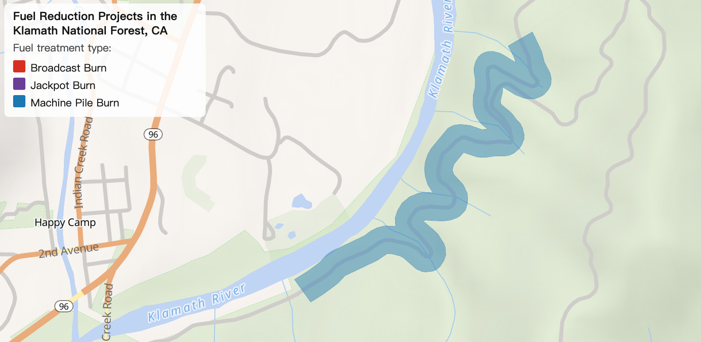
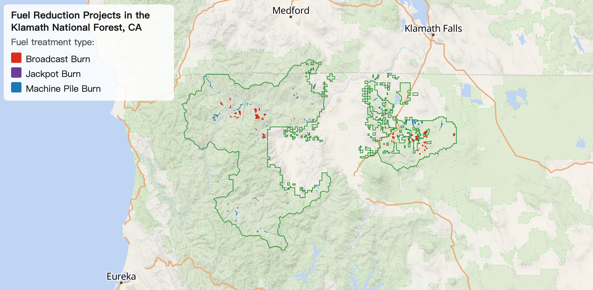

# Mapping Fuel Reduction Projects in the Klamath National Forest, California

Link: https://jieenyang.github.io/jieenyang-web/geos472-lab-1/

## Reflective Analysis - Purpose 

As wildfires in California intensified in frequency and intensity in the past decade, there has been an increasing number of policy initiatives to expand fuel treatments. Prescribed fires, the use of controlled burning to remove combustible vegetation, are among the most common methods of fuel treatment. California governor’s executive order B-52-18, issued in May 2018, directed the Department of Forestry and Fire Protection (CAL FIRE) to accelerate prescribed fire projects, and to “integrate fire prevention activities into landscape forest restoration efforts in and near Wildland-Urban Interface areas” (p. 2). In January 2021, California’s Wildfire and Forest Resilience Action Plan further stipulated that CAL FIRE and Caltrans will implement fuel reduction projects on “2,600 miles of high-risk roadways” to protect travelers and reduce roadside ignitions along emergency evacuation routes (p. 33).

Two questions can emerge from this context: (1) Among these fire-based fuel reduction projects, what is the most popular type of fuel treatment? (2) As of 2025, have agencies begun implementing projects along Wildland-Urban Interface areas and the state’s highway system to protect residents and travellers? To answer these questions, my map aims to empirically illustrate existing fuel reduction efforts through a case study of fuel treatments implemented in northern California’s Klamath National Forest. Using a dataset of national forests in the United States, I was able to clip prescribed fire polygons from California’s Fire and Resource Assessment Program (FRAP) to the study area. Ideally, my resulting map will illustrate both the geometry and the treatment type associated with each record, in addition to mere locations.

## Reflective Analysis - Design Choices 

To meet these goals, I chose OpenFreeMap’s Liberty style as the base map because it contains enough topographic information to begin working with; however, I removed most of its built-in layers, including points of interest, airports, tunnels, bridges, rail lines, and several land use categories that have nothing to do with the placement of fuel treatments. I also removed labeling layers unnecessary at this spatial scale, such as country name and national borders. On the other hand, layers that I decided to keep include the residential land use category, vegetation land cover categories, roads, and water, which either has an effect on the location of fuel treatment placement or provides appropriate contextual information at this spatial scale.

The most important data layer is the fuel treatment polygons, which are coloured by the Treatment_Type property in the linked GeoJSON file using a categorical colour scheme. These treatment polygons are fully opaque up to zoom level 9. From that point, they gradually become more transparent as the user zooms in further, until opacity reaches 4.5 at zoom level 13. This allows the road network, land cover, and terrain underneath to show through the polygons when looking at specific projects (see Screenshot 1). The design also addresses question (2) regarding whether treatments are indeed implemented along urban boundaries and roadways, as identified in the literature review.

Screenshot 1: Fuel Treatment near Happy Camp, Klamath National Forest

In addition, I added the Klamath National Forest boundary as a green outline to provide locational context for the study area. The forest boundary is opaque when zoomed out, and gradually fades as the user zooms in. This is because the boundary will only become useful when the users zoom out to a scale too small to see the treatment polygons themselves, helping them remember where the study area is even if they navigate away from it (see Screenshot 2).

Screenshot 2: Overview of the Study Area

The placement fuel reduction projects inevitably follow, or are constrained by, topography. Therefore, I added a terrain shading tiles layer developed by the open-source mapping company Mapzen and hosted on Amazon Web Service’s Registry of Open Data. This data is accessed from: https://s3.amazonaws.com/elevation-tiles-prod/terrarium/{z}/{x}/{y}.png, which has been cited in a tutorial on GitHub and described as requiring no keys (https://github.com/maplibre/maplibre-agent-skills/issues/19). Its tile size is set to 256 pixels to match OpenFreeMap’s default for consistency.

## Reflective Analysis - Areas of Improvement:

Because access routes are part of the decision logic for fuel treatment placement as described in the policy literature, I attempted to manage the zoom settings for smaller secondary and tertiary roads such that they appear at smaller zoom levels. However, it appears that the base map has pre-determined the levels at which secondary and tertiary roads will appear as features, overriding the manual zoom settings. One way to resolve this issue in the future is to remove these layers from OpenFreeMap and, instead, import a new vector road network URL from other online datasets. More broadly speaking, the map can benefit from additional interactivity components, such as allowing users to hover the mouse over each fuel treatment polygon and illustrate its attribute data otherwise not represented using visual elements.

## Peer Critique:

In general, my peers found the map easy to understand, but I did receive suggestions that (1) the colour of water is too bright, (2) the name labels of cities or towns are too crowded and may take away from the map’s focus, and (3) the study area boundary should remain somewhat visible even at higher zooms. Therefore, I lightened the water colour, as well as adjusted the zoom settings for place name labels and the study area boundary. In this lab, generative AI was used specifically to search for a free terrain shading tile data source, which was suggested to be the Mapzen terrain data hosted on AWS.
