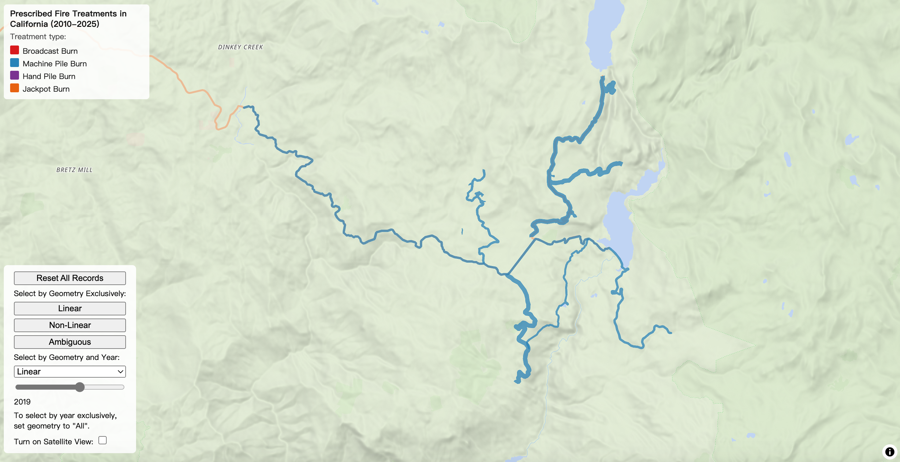
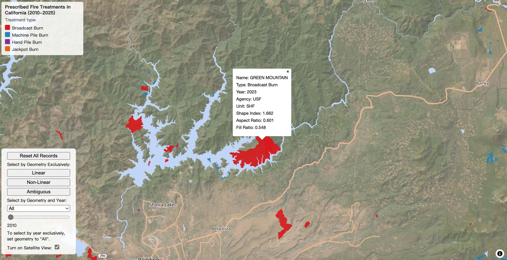

# The Evolution of Spatial Characteristics of Fuel Reduction Projects in California, 2010-25

Link: https://jieenyang.github.io/jieenyang-web/geos472-lab-2/

## Reflective Analysis - Purpose and Audience

Under Professor Tina Liu’s supervision, I have done some preliminary research into the evolution of the spatial characteristics of fuel reduction projects in California. As I briefly wrote about in my reflective analysis for Lab 1, a number of initiatives have been adopted in California to promote the use of prescribed fire and linear fuel breaks. The most notable initiatives with relevance to fuel treatment geometry are: (1) California Governor’s Executive Order B-52-18, which mandated a focus on fire prevention near Wildland-Urban Interface (WUI) areas; (2) Senate Bill 901, which mandated vegetation clearance along utility transmission corridors; (3) the Community Wildfire Prevention & Mitigation Report, directed by Executive Order N-05-19, which identified a number of WUI areas for treatment across 21 counties; and (4) California’s Wildfire and Forest Resilience Action Plan, which aims to implement fuel reduction projects along 2,600 miles of high-risk roadways. The successful implementation of these plans has important implications for mitigating the risk of wildfire ignition, protecting residential areas, preserving public evacuation routes, and, ultimately, protecting public safety.

In this context, one major question I am interested in exploring is whether these initiatives have indeed translated into more linear fuel treatments implemented on the ground, as the above policies hope to achieve. The first metric I used to measure linearity is the Shape Index, where higher values represent a more elongated shape. Time-series trend analysis consistently indicates a rising trend in SI, supporting an increase in linearity. To rule out confounding variables, two geometry-based metrics were designed to distinguish fuel reduction projects as linear, non-linear, or ambiguous: aspect ratio and fill ratio. The rising trend can be isolated to the linear segment of the dataset, meaning that linear fuel treatments (typically machine pile burns) have become longer over time, whereas non-linear treatments, such as broadcast burns that simply burn over an expanse without much deliberate geometry planning, remain unaffected by those policies.

I will be presenting some of the above preliminary research results in Dr. Liu’s lab meeting, but I always thought it could benefit from a map-based visualization to help elucidate the findings. After receiving Dr. Liu’s approval to use our preprocessed GeoPackage of CAL FIRE fuel treatment polygons, along with some of her suggestions, this exploratory lab gave me the perfect opportunity to do so. This map is therefore designed to allow the audience to explore the evolution of the spatial characteristics of roughly 5,700 California prescribed fire and fuel treatment projects from 2010 to 2025, as well as to view the attribute data relevant to each record’s linearity along the way. My aim is for the map user to be able to effortlessly comprehend not only the shape class (i.e., linear, non-linear, ambiguous) of a treatment project, but also its correlated attributes, including treatment type (e.g., broadcast burn, pile burn), agency, the aforementioned linearity metrics, and year of treatment. That said, there are questions this map does not answer, even though they are considered equally or more important research areas, such as the treatment’s effectiveness in slowing fire spread or reducing future wildfire intensity.

## Reflective Analysis - Design Choices 

The map’s design process builds on what I completed in Exploratory Lab 1, such as classifying treatment types by colour and drawing a legend entry for the colour scheme using p5. This time, I also added a number of interactivity features, most of which serve to filter the data according to different attributes upon registering certain events. The first element of my controls panel is the reset button, referencing the onEachTree function from the MapLibre UBC class example, as a way for the user to set everything back to the default, unfiltered version of the map. The next three buttons in the container apply the same filtering logic as the Filtering MapLibre example, filtering respectively for linear, non-linear, and ambiguous records across all years. However, they filter exclusively by geometry, even though an equally important variable in my research question is time. Therefore, the next two features allow the user to filter by geometry and year simultaneously. The geometry filter here is a dropdown, because it is intended to be combined with the time filter, and I wanted to make this relationship more obvious by keeping the geometry filter more compact. AG and I began searching for online tutorials for creating a dropdown menu together in class, and I later did further research on my own using Google AI, following along with the tutorial from developer.mozilla.org. For the time filter, since the range runs from 2010 to 2025, the most intuitive choice would be a slider, so I adapted the slider example from the Turf.js tutorial in class. With this design, it is also functionally possible to filter exclusively by year, as long as the geometry is set to “all”, so I refrained from adding a second slider dedicated to filtering all records by year irrespective of geometry type.

Screenshot 1: Fuel breaks in Sequoia National Park, California, with geometry set to “Linear” and year set to “2019”.

In addition to filtering, I also expanded the attributes displayed in the popup to include the shape index, aspect ratio, and fill ratio, all of which are relevant to the metric-based geometry classification of each polygon. I also took the advise from my Exploratory Lab 1 feedback to consider using a desaturated satellite image raster to provide more context for fuel treatment location planning. I therefore decided to bring in a satellite layer, and after searching with Google AI, I found an XYZ-scheme web API for tiled satellite imagery hosted this time by ESRI at the following link: https://server.arcgisonline.com/ArcGIS/rest/services/World_Imagery/MapServer/tile/{z}/{y}/{x}. I further adjusted its brightness settings as a function of zoom level, so that at lower zoom levels the satellite imagery does not visually interfere with the fuel treatment polygons, while at higher zoom levels the land cover becomes more visible to provide contextual information on land cover and fuel type. I also decided to keep the rest of the base map from the previous lab, because it contains the locations of national and state forests in California, serving as another important contextual layer, as many treatments are carried out by divisions at each national forest under the US Forest Service.

Screenshot 2: Broadcast burn near Lake Shasta, California, with the popup illustrating relevant attribute information.

## Reflective Analysis - Areas of Improvement and AI Use:

The shape metrics used for linearity classification in this exploratory lab were previously calculated using the sf package in R, before the dataset was converted from GeoPackage to GeoJSON. I could have derived them using the Turf library instead, but I think it is important to make a clear distinction between my work elsewhere and my work for this class, so I kept the original attributes unaltered, and reference the context here instead. In addition, AG, Sean, and I gave each other’s maps some feedback, where I noticed that their maps use Turf to find all points of interest within a certain radius of a click on the map, similar to the Turf example; however, I could not think of a solid use case for visualizing my data this way, so I did not include something similar. That said, this is something I would love to try out using the Turf package in the future. In this lab, generative AI was used to search for CSS tutorials on styling and positioning the layout of the controls panel (https://developer.mozilla.org/en-US/docs/Learn/CSS/CSS_layout/Positioning & https://developer.mozilla.org/en-US/docs/Learn/CSS/CSS_layout/Flexbox), a tutorial example for creating a dropdown menu (https://developer.mozilla.org/en-US/docs/Web/HTML/Reference/Elements/option), and a checkbox for the satellite view toggle (https://www.w3schools.com/tags/att_input_type_checkbox.asp & https://maplibre.org/maplibre-gl-js/docs/examples/filter-symbols-by-toggling-a-list/), so that I could follow along to make my own adaptations, as well as asking follow-up questions if I have any questions about the example. Finally, I used AI to help me find a free raster satellite imagery API, which was suggested to be the tiled satellite imagery hosted by ESRI.

